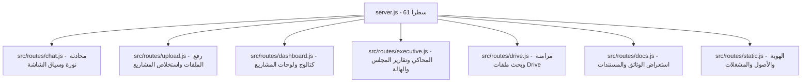

# دليل المزايا والقدرات الجديدة الشامل · منصة تُجّار ونورة الذكية
### Comprehensive Guide to New Features & Architecture Upgrades
**اتحاد الغرف التجارية السعودية · Federation of Saudi Chambers**
*تاريخ التحديث: نوفمبر 2026 · الفرع: `feat/executive-wow-suite`*

---

## 📌 الفهرس التنفيذي
1. [مقارنة سريعة: الفرع الأصلي (main) مقابل النسخة المطورة](#1-مقارنة-سريعة-الفرع-الأصلي-main-مقابل-النسخة-المطورة)
2. [المزايا والقدرات الجديدة بالتفصيل](#2-المزايا-والقدرات-الجديدة-بالتفصيل)
   - [أولاً: محاكي القرارات الاستراتيجي بالذكاء الاصطناعي (AI What-If Simulator)](#أولاً-محاكي-القرارات-الاستراتيجي-بالذكاء-الاصطناعي-ai-what-if-simulator)
   - [ثانياً: الاستخلاص والاكتشاف التلقائي للمشاريع (Dynamic Project Discovery)](#ثانياً-الاستخلاص-والاكتشاف-التلقائي-للمشاريع-dynamic-project-discovery)
   - [ثالثاً: لوحات القيادة المستقلة لكل مشروع (Independent Project Dashboards)](#ثالثاً-لوحات-القيادة-المستقلة-لكل-مشروع-independent-project-dashboards)
   - [رابعاً: كابينة القيادة الجانبية المتوافقة مع معايير Apple HIG](#رابعاً-كابينة-القيادة-الجانبية-المتوافقة-مع-معايير-apple-hig)
   - [خامساً: محادثة نورة المدركة للشاشة لحظياً (Live Screen-Aware AI Chat)](#خامساً-محادثة-نورة-المدركة-للشاشة-لحظياً-live-screen-aware-ai-chat)
   - [سادساً: حزمة تقارير مجلس الإدارة (Board PDF & WhatsApp Reports)](#سادساً-حزمة-تقارير-مجلس-الإدارة-board-pdf--whatsapp-reports)
   - [سابعاً: أداة تسليط الضوء للعروض التنفيذية (Screen Spotlight Tool)](#سابعاً-أداة-تسليط-الضوء-للعروض-التنفيذية-screen-spotlight-tool)
   - [ثامناً: المزامنة السحابية الذكية مع Google Drive وفحص البصمة (SHA-256 Deduplication)](#ثامناً-المزامنة-السحابية-الذكية-مع-google-drive-وفحص-البصمة-sha-256-deduplication)
   - [تاسعاً: خط أنابيب المعرفة الذاتية وتخزين الكائنات السحابي (Auto-DK & S3 Storage)](#تاسعاً-خط-أنابيب-المعرفة-الذاتية-وتخزين-الكائنات-السحابي-auto-dk--s3-storage)
   - [عاشراً: البث المباشر السحابي ومشغلات العرض 1080p (Google Drive Streaming Players)](#عاشراً-البث-المباشر-السحابي-مشغلات-العرض-1080p-google-drive-streaming-players)
3. [الهندسة المعمارية وإعادة الهيكلة البرمجية (<100 Lines Server Rule)](#3-الهندسة-المعمارية-وإعادة-الهيكلة-البرمجية)
4. [دليل مسارات الواجهة البرمجية الجديدة (New API Endpoints)](#4-دليل-مسارات-الواجهة-البرمجية-الجديدة-new-api-endpoints)
5. [روابط الموارد السحابية على Google Drive](#5-روابط-الموارد-السحابية-على-google-drive)

---

## 1. مقارنة سريعة: الفرع الأصلي (`main`) مقابل النسخة المطورة

```
┌─────────────────────────────────────────────────────────────────────────────────────────┐
│                                 مقارنة القدرات الجوهرية                                 │
├───────────────────────────────┬─────────────────────────────┬───────────────────────────┤
│ الميزة / القدرة               │ الفرع الأصلي (main)         │ النسخة المطورة (الحالية)  │
├───────────────────────────────┼─────────────────────────────┼───────────────────────────┤
│ عدد المشاريع في المحفظة       │ 5 مشاريع ثابتة وراكدة       │ ديناميكي: ينمو آلياً (7+) │
│ تفاعل محاكي القرارات (What-If)│ غير متوفر (أو حسابات جامدة) │ ذكاء اصطناعي + 4 حزم قرارات│
│ لوحات القيادة (Dashboards)    │ لوحة واحدة فقط للملف        │ لوحة مستقلة لكل مشروع     │
│ إدراك الشاشة في المحادثة      │ غائب (تطلب نورة تزويدها)    │ إدراك لحظي كامل للشاشة    │
│ واجهة المحادثة والتنسيق       │ نصوص Markdown خام غير منسقة │ بطاقات Apple HIG + نسخ وصوت│
│ تقارير المجلس                 │ غير متوفرة                  │ PDF رسمي مرمز + واتساب    │
│ قاعدة البيانات                │ SQLite فقط (ملف محلي)       │ ثنائية: PostgreSQL + SQLite│
│ تخزين الملفات                 │ مجلد محلي فقط               │ محول سحابي (S3/R2/MinIO)   │
│ مزامنة Google Drive           │ رفع باتجاه واحد وبدون فحص   │ مزامنة ثنائية + فحص SHA256 │
│ حجم ملف server.js             │ ملف أحادي ضخم (~700+ سطر)   │ 61 سطراً فقط (معياري)     │
│ بث العروض المرئية             │ ملفات محلية فقط             │ بث سحابي مباشر من Drive   │
└───────────────────────────────┴─────────────────────────────┴───────────────────────────┘
```

---

## 2. المزايا والقدرات الجديدة بالتفصيل

### أولاً: محاكي القرارات الاستراتيجي بالذكاء الاصطناعي (AI What-If Simulator)
* **المسار البرمجي:** `src/executive/simulator.js` و `public/js/simulator.js`
* **المفهوم:** تمكين متخذ القرار من تجربة سيناريوهات استراتيجية معقدة ورؤية الأثر المالي والزمني فورياً على محفظة المشاريع.
* **القدرات المضافة:**
  1. **حسابات رياضية لحظية دقيقة:**
     - **الأيام المكتسبة أو المفقودة (Days Gained/Lost):** حساب تقدم أو تعثر المشاريع بالأيام.
     - **تغير معدل الحرق اليومي (Daily Burn Rate Delta):** حساب وفر أو زيادة الصرف اليومي بالريال السعودي ونسبته المئوية.
     - **ضغط السيولة (Capital Pressure):** قياس نسبة السيولة التشغيلية المستهلكة مقارنة بالميزانية المعتمدة.
  2. **أربع حزم قرارات استراتيجية جاهزة مسبقاً بنقرة واحدة:**
     - 🚀 **حزمة الإنقاذ والتسريع (Rescue & Acceleration):** ضخ 25% ميزانية إضافية للمشاريع الحرجة لكسب 45 يوماً وخفض معدل التعثر.
     - ⚖️ **ضبط الموازنة والسيولة (Budget & Liquidity Control):** كبح الصرف بنسبة 20% لتحقيق وفر مالي قدره 1.2M ريال مع تمديد معتدل للمهل.
     - 🛡️ **الامتثال السيبراني والأمان (Cybersecurity & Compliance):** إعادة توجيه الموارد لحماية البنية السحابية وإغلاق الثغرات الحرجة.
     - 🔄 **إعادة هيكلة التعاقد (Contract Restructuring):** فض النزاعات التعاقدية وتغيير مقاولي التنفيذ للمشاريع المتعثرة.
  3. **تحليل السيناريو المفتوح بالذكاء الاصطناعي (Freeform AI Query):**
     - إمكانية كتابة أي استفسار باللغة الطبيعية (مثل: *"ماذا يحدث لو ضاعفنا ميزانية مشروع السحابة وأوقفنا الرخص؟"*).
     - استجابة Gemini 2.5 Flash بصياغة **«توصية نورة للمجلس التنفيذي 🏛️»** مع تحليل المخاطر وفرص النجاح.

---

### ثانياً: الاستخلاص والاكتشاف التلقائي للمشاريع (Dynamic Project Discovery)
* **المسار البرمجي:** `src/executive/project-sync.js` مدمجاً مع `src/routes/upload.js`
* **المفهوم:** إنهاء مشكلة جمود بيانات المشاريع (التي كانت تقتصر دائماً على 5 مشاريع).
* **القدرات المضافة:**
  - عند رفع أي وثيقة تدقيق أو مراجعة محاسبية (مثل: `14_تقرير_المراجعة_المحاسبية_وتدقيق_تناقضات_المشاريع.md`):
    - يقوم النظام عبر خوارزمية ذكية بفحص نصوص الجداول والملاحظات.
    - يستخلص المشاريع غير المسجلة آلياً (مثل: *مشروع منظومة الذكاء الاصطناعي للغرف*، *مشروع تحديث البنية التحتية للأمانة العامة*).
    - يستخرج ميزانياتها، مصروفاتها، ونسب إنجازها وحالتها (متعثر/متأخر).
    - يضيفها فوراً إلى قاعدة البيانات الحية، ليرتفع عدد المشاريع من **5 إلى 7 مشاريع**.
    - يحدّث بطاقات المؤشرات (KPIs) في صدارة المنصة لحظياً بدون إعادة تحميل الصفحة.
    - ينشئ لوحات قيادة مستقلة تلقائياً للمشاريع المكتشفة حديثاً.

---

### ثالثاً: لوحات القيادة المستقلة لكل مشروع (Independent Project Dashboards)
* **المسار البرمجي:** `src/routes/dashboard.js` و `dash.html` و `src/dashboard/seed.js`
* **المفهوم:** توفير داشبورد تحليلي مستقل ومفصل لكل مشروع على حدة بدلاً من الاكتفاء بداشبورد عام للملف.
* **القدرات المضافة:**
  - **قائمة تبديل سريعة في رأس الصفحة (`#fdSelect` / `#dashCatalog`):** تتيح للمدير التنفيذي التنقل بلمسة واحدة بين لوحة المحفظة العامة ولوحة أي مشروع فرعي.
  - **رسوم ECharts تفاعلية متقدمة ومبنية على البيانات الحقيقية:**
    - مقارنة الميزانية المعتمدة بالمصروف الفعلي لكل مشروع.
    - رسم بياني لحالة التذاكر والبلاغات ومعدلات الإغلاق.
    - مؤشرات نسب الإنجاز الدائرية (Gauges).
  - **معالجة الترجمة والنسب المئوية:** حصانة كاملة ضد أخطاء المتصفحات التي كانت تحول علامة `%` إلى كلمة `percent`، مع دعم التنسيق العربي الأصيل `٪`.

---

### رابعاً: كابينة القيادة الجانبية المتوافقة مع معايير Apple HIG
* **المسار البرمجي:** `public/js/ui.js` و `public/css/components.css`
* **المفهوم:** إعادة تصميم كاملة لتجربة المستخدم (UX/UI) لتتحول من نوافذ منبثقة عشوائية تحجب الرؤية إلى كابينة قيادة تنفيذية راقية.
* **القدرات المضافة:**
  1. **الدرج الجانبي الموحد (Side Cockpit Drawer):**
     - ينزلق بسلاسة من الجانب الأيسر دون حجب محتوى الداشبورد أو جداول المشاريع في المنتصف.
     - مساحة عمل متكاملة تجمع سجل المحادثة، حالة الاتصال، وأزرار التحكم.
  2. **بطاقات الردود التنفيذية الذكية (Executive Cards):**
     - تم التخلص نهائياً من الـ Markdown الخام (الذي كان يظهر على هيئة `### 1.` و `**نص**`).
     - تحويل كافة إجابات نورة إلى بطاقات مصممة بهوية اتحاد الغرف السعودية:
       - وسوم ذهبية مميزة لكل نقطة.
       - زر **نسخ التقرير (Copy)** بنقرة واحدة.
       - زر **استمع للرد (TTS Playback)** لإعادة سماع النص بصوت نورة.
  3. **توافق كامل مع معايير إمكانية الوصول (WCAG 2.1 AA) و Apple HIG:**
     - مساحات لمسية مريحة (Touch Targets >= 44px).
     - تبويب وتنقل سلس عبر لوحة المفاتيح مع دعم الإغلاق بمفتاح `Esc`.

---

### خامساً: محادثة نورة المدركة للشاشة لحظياً (Live Screen-Aware AI Chat)
* **المسار البرمجي:** `src/routes/chat.js` و `public/js/app.js`
* **المفهوم:** أن تكون نورة مستشاراً حقيقياً يرى ما يراه المستخدم على الشاشة ويتحدث عنه بدقة دون الحاجة لشرح أو رفع متكرر.
* **القدرات المضافة:**
  - يرسل العميل مع كل استفسار **سياق الشاشة الحي (Screen Context)** متضمناً: اللوحة المعروضة حالياً، المؤشرات الرقمية، العناوين البارزة، والرسوم الظاهرة.
  - دعم مسار محادثة احتياطي فائق السرعة عبر REST API (`/api/chat/message`) مدعوماً بنموذج Gemini 2.5 Flash أو FreeLLMAPI لضمان عدم توقف المحادثة في حال انقطاع الـ WebSocket.
  - **حماية استجابة "لخص المعروض":** تم وضع قواعد صارمة للنموذج تمنعه من قول *"أحتاج تزويدي بالمحتوى"* عندما يكون المستخدم فاتحاً لداشبورد أو وثيقة، مع توليد تلخيص تنفيذي فوري مستند إلى الأرقام المعروضة أمامه.

---

### سادساً: حزمة تقارير مجلس الإدارة (Board PDF & WhatsApp Reports)
* **المسار البرمجي:** `src/executive/report.js` و `public/js/report.js`
* **المفهوم:** تحويل بيانات المشاريع بنقرة واحدة إلى مخرجات جاهزة للاجتماعات والقرارات القيادية.
* **القدرات المضافة:**
  1. **تقرير مجلس الإدارة الرسمي (PDF):**
     - مولد PDF مرمز ومبني برمجياً عبر `pdf-lib`.
     - يتضمن الهوية الرسمية لاتحاد الغرف التجارية السعودية وشعار رؤية المملكة 2030.
     - جداول ملونة بالمشاريع، نسب الإنجاز، مؤشرات الصرف المالي، وتوصيات التعافي.
  2. **صيغة الواتساب التنفيذية (WhatsApp Markdown):**
     - نص مهيأ بالرموز التعبيرية القيادية (Emojis) والتنسيقات النقطية الجاهزة للإرسال الفوري لجروبات المجلس عبر الهاتف المحمول.
  3. **نافذة الاستعراض والمشاركة (`#boardReportModal`):**
     - إمكانية معاينة التقرير مباشرة، نسخه للحافظة، أو تنزيل ملف الـ PDF.

---

### سابعاً: أداة تسليط الضوء للعروض التنفيذية (Screen Spotlight Tool)
* **المسار البرمجي:** `src/executive/spotlight.js` و `public/js/spotlight.js`
* **المفهوم:** أداة تفاعلية للمتحدثين أثناء العرض على شاشات الاجتماعات الكبيرة.
* **القدرات المضافة:**
  - عند الإشارة إلى مشروع أو رقم معين أثناء العرض الحي، تسقط هالة ذهبية مضيئة ومركزة على البطاقة المستهدفة (`executive:spotlight`).
  - تعتيم لطيف لبقية الشاشة لتركيز انتباه أعضاء مجلس الإدارة على البيانات محل النقاش.

---

### ثامناً: المزامنة السحابية الذكية مع Google Drive وفحص البصمة (SHA-256 Deduplication)
* **المسار البرمجي:** `src/drive/sync.js` و `drive.js`
* **المفهوم:** أرشفة ومزامنة آمنة ثنائية الاتجاه مع سحابة Google Drive بدون تكرار أو هدر في مساحات التخزين ومعالجة الـ AI.
* **القدرات المضافة:**
  - فحص بصمة الملف الرقمية (SHA-256 Hash) قبل المعالجة؛ في حال رفع ملف مكرر يتم التعرف عليه فوراً وربطه بالسجل القائم دون تكرار أرشفته أو مضاعفة متجهات الـ RAG في قاعدة البيانات.
  - آلية استطلاع ومزامنة خلفية مجدولة (Polling Sync) تسحب الملفات والتقارير الجديدة من مجلد Drive المعتمد تلقائياً.

---

### تاسعاً: خط أنابيب المعرفة الذاتية وتخزين الكائنات السحابي (Auto-DK & S3 Storage)
* **المسار البرمجي:** `src/ingest/auto-dk.js` و `src/storage/`
* **القدرات المضافة:**
  - **Auto-DK (Autonomous Data & Knowledge):** خط معالجة ذاتي يستخلص الجداول من ملفات Excel و CSV و PDF ويحولها إلى حزم معرفية موحدة (`fawaz-dk-bundle/1`) تغذي محرك البحث الدلالي (RAG).
  - **محول التخزين السحابي العالمي (Unified Storage Adapter):** دعم موحد وقابل للتبديل لكل من:
    - Amazon S3
    - Cloudflare R2
    - Supabase Storage
    - MinIO
    - والتخزين المحلي المحلي (LocalStorage) مع دعم التوقيع المشفر AWS SigV4.

---

### عاشراً: البث المباشر السحابي ومشغلات العرض 1080p (Google Drive Streaming Players)
* **المسار البرمجي:** `scripts/record_full_demo_video.mjs` و `demo_showcase_player.html` و `demo_original_branch_player.html`
* **القدرات المضافة:**
  - توليد فيديو استعراضي شامل بدقة **1080p Full HD** بستين إطاراً في الثانية يعرض رحلة متكاملة عبر 8 مشاهد لكل إمكانيات المنصة.
  - إنشاء **مشغل ويب تفاعلي (HTML Player)** يبث الفيديو سحابياً ومباشرة عبر مشغل Google Drive المدمج دون الحاجة لوجود ملفات وسائط على جهاز المستخدم.
  - دعم التنقل اللحظي بين الفصول التنفيذية الـ 8 بضغطة زر واحدة.
  - توفير نسختين مستقلتين من العروض والمشغلات:
    1. عرض المنصة الحديثة المطورة (`demo_showcase_player.html`).
    2. عرض الفرع الأساسي الأصلي للمقارنة والتوثيق (`demo_original_branch_player.html`).

---

## 3. الهندسة المعمارية وإعادة الهيكلة البرمجية

### قاعدة الـ 100 سطر لملف السيرفر (`server.js`)
تم تفكيك ملف `server.js` الضخم (الذي كان يتجاوز 700 سطر في الفرع الأصلي) إلى بنية معيارية نظيفة، حيث استقر الملف الرئيسي عند **61 سطراً فقط**، موزعة المسؤوليات عبر مسارات متخصصة:



### البنية التحتية الثنائية لقواعد البيانات (`db.js`)
- دعم شفاف للتشغيل على **PostgreSQL** و **SQLite** في آن واحد.
- محول آلي للاستعلامات يترجم الفروقات الجوهرية (مثل `ILIKE` في Postgres مقابل `LIKE` في SQLite، و `JSONB` مقابل نصوص JSON) بدون أي تعديل في كود الأعمال.

---

## 4. دليل مسارات الواجهة البرمجية الجديدة (New API Endpoints)

| المسار البرمجي (Endpoint) | الطريقة (Method) | الوظيفة التنفيذية |
| :--- | :--- | :--- |
| `/api/chat/message` | `POST` | إرسال رسالة نصية لنورة مع تمرير كامل سياق الشاشة واللوحة الحالية |
| `/api/executive/simulate` | `POST` | تشغيل محاكي القرارات (حساب الأيام، وفر الحرق، وتحليل Gemini) |
| `/api/executive/report/pdf` | `POST` / `GET` | توليد وتنزيل تقرير مجلس الإدارة بصيغة PDF الرسمية |
| `/api/executive/report/whatsapp` | `POST` | توليد نص التقرير التنفيذي المهيأ للمشاركة عبر الواتساب |
| `/api/executive/spotlight` | `POST` | تفعيل الهالة الذهبية وتسليط الضوء على عنصر بالداشبورد أثناء العرض |
| `/api/dashboards/catalog` | `GET` | جلب القائمة الكاملة لكافة لوحات المحفظة والمشاريع المستقلة |
| `/api/drive/sync` | `POST` | إطلاق فحص ومزامنة فورية ثنائية الاتجاه مع Google Drive |
| `/api/drive/status` | `GET` | استعلام حالة المزامنة وبصمات الملفات المفحوصة في السحابة |

---

## 5. روابط الموارد السحابية على Google Drive

كافة الوثائق والعروض المرئية تم رفعها وتكاملها سحابياً مع حساب Google Drive الخاص بك في تصنيف **«التقارير والعروض»**:

### أولاً: موارد المنصة المطورة (Executive WOW Suite)
* **مشغل العرض التفاعلي السحابي (HTML):**
  [العرض المرئي التنفيذي الشامل](https://drive.google.com/file/d/1POO0rogYM-HjtGb7My7U5ztcADNAz95B/view?usp=drivesdk) `(ID: 1POO0rogYM-HjtGb7My7U5ztcADNAz95B)`
* **فيديو العرض التنفيذي بدقة 1080p (MP4):**
  [فيديو العرض التنفيذي الشامل](https://drive.google.com/file/d/1PMgPLOoXBJs9fUw-flvmv1UtnVdLP21d/view?usp=drivesdk) `(ID: 1PMgPLOoXBJs9fUw-flvmv1UtnVdLP21d)`
  - *رابط البث السحابي المباشر:* [Google Drive Stream Preview](https://drive.google.com/file/d/1PMgPLOoXBJs9fUw-flvmv1UtnVdLP21d/preview)

### ثانياً: موارد الفرع الأصلي (Baseline main)
* **مشغل عرض الفرع الأصلي (HTML):**
  [مشغل عرض الفرع الأصلي](https://drive.google.com/file/d/1pgUpT5JZTnWAci7mRy3MM5yalcfY-vBm/view?usp=drivesdk) `(ID: 1pgUpT5JZTnWAci7mRy3MM5yalcfY-vBm)`
* **فيديو عرض الفرع الأصلي بدقة 1080p (MP4):**
  [فيديو عرض الفرع الأصلي](https://drive.google.com/file/d/1FVFVcLEk0f4-sjzrOV3bfx5cCuMfMe2g/view?usp=drivesdk) `(ID: 1FVFVcLEk0f4-sjzrOV3bfx5cCuMfMe2g)`
  - *رابط البث السحابي المباشر:* [Google Drive Stream Preview](https://drive.google.com/file/d/1FVFVcLEk0f4-sjzrOV3bfx5cCuMfMe2g/preview)

---

### 🧪 التحقق والاختبارات
* **حزمة الاختبارات:** **113/113** اختبار وحدة (Unit Tests) بنسبة نجاح 100%.
* **فحوصات الواجهة والتصميم:** **20/20** فحص واجهة (UI/UX Checks) بنسبة نجاح 100%.
* **معايير الكود:** ملف `server.js` مستقر عند **61 سطراً**.
